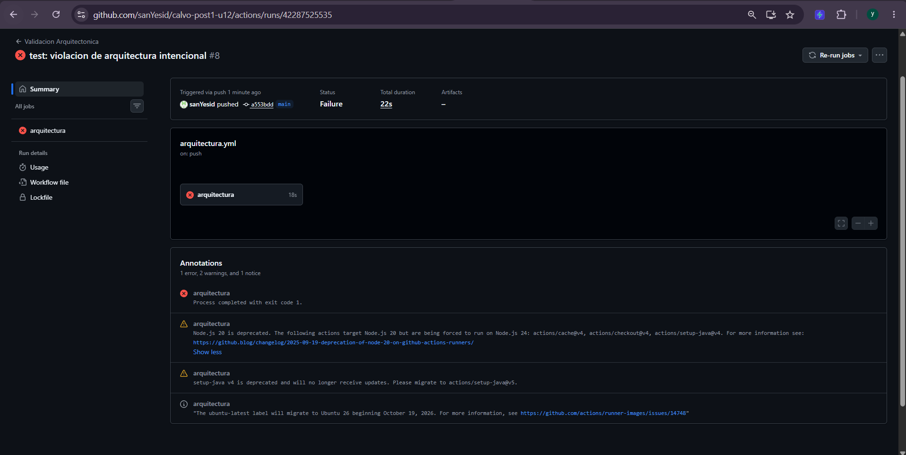
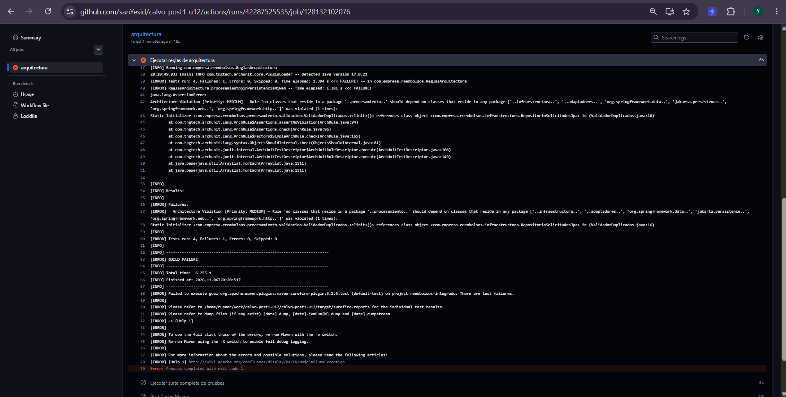
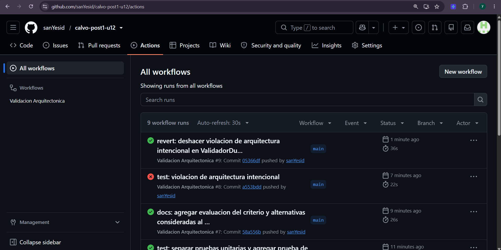

# Sistema de Solicitudes de Reembolso de Gastos Corporativos

**Post-contenido — Proyecto Integrador (Unidad 12 · Patrones de Diseño de Software)**

Sistema backend construido con **Java 17**, **Spring Boot 3**, **Spring Data JPA (H2)** y **ArchUnit 1.2.1** para gestionar el registro, la validación en múltiples etapas, el cálculo de montos aprobados según la categoría del gasto y la notificación simultánea a múltiples interesados ante cambios de estado en solicitudes de reembolso corporativo.

## Contenido

1. [Diseño Propuesto](#diseño-propuesto)
2. [Arquitectura Resultante y Estructura de Paquetes](#arquitectura-resultante-y-estructura-de-paquetes)
3. [Decisiones de Diseño (1 a 4)](#decisiones-de-diseño-1-a-4)
4. [Resumen del ADR-001](#resumen-del-adr-001)
5. [Qué se descartó y por qué](#qué-se-descartó-y-por-qué)
6. [Pruebas](#pruebas)
7. [Evidencia del Pipeline de GitHub Actions](#evidencia-del-pipeline-de-github-actions)
8. [Cómo ejecutar](#cómo-ejecutar)

## Diseño Propuesto

Antes de escribir el código de los patrones, se analizan los tres requisitos funcionales del sistema identificando su punto de variabilidad concreto, el patrón de diseño GoF que lo resuelve y su justificación aplicando el test de explicabilidad en una oración:

| Requisito | Punto de variabilidad concreto | Patrón de diseño propuesto | Justificación (Test de explicabilidad en una oración) |
| :--- | :--- | :--- | :--- |
| **RF1 — Validación en varias etapas** | La secuencia y cantidad de reglas de verificación independientes (tope por categoría, documentos soporte, duplicados en el período y futuras reglas como el límite anual acumulado) que pueden rechazar prematuramente una solicitud antes de aprobarse. | **Chain of Responsibility** | Se elige **Chain of Responsibility** (y no un condicional monolítico ni una lista rígida) porque permite encadenar verificaciones desacopladas con cortocircuito inmediato al primer rechazo e incorporar nuevas reglas de validación en el futuro sin modificar los validadores existentes ni el servicio cliente. |
| **RF2 — Cálculo distinto por categoría de gasto** | El algoritmo matemático de cálculo del monto aprobado según la categoría del gasto (`VIAJE` por tope diario multiplicado por días, `REPRESENTACION` por tope mensual, `CAPACITACION` al 80% hasta tope anual, y futuras categorías como bienestar). | **Strategy** | Se elige **Strategy** (y no un `switch`/`if-else` en el servicio ni herencia sobre la entidad `SolicitudReembolso`) porque encapsula cada fórmula de reembolso en una clase independiente bajo una interfaz común, permitiendo seleccionar el algoritmo según la categoría y agregar nuevas categorías sin modificar las calculadoras existentes. |
| **RF3 — Notificación simultánea a varios interesados** | El conjunto de módulos suscriptores (empleado, contabilidad, auditoría interna y futuros interesados como el panel de métricas de Finanzas) y la reacción específica que cada uno ejecuta cuando una solicitud cambia de estado. | **Observer** | Se elige **Observer** (y no llamadas directas acopladas dentro del servicio de aplicación) porque permite que múltiples interesados reaccionen simultáneamente y con su propia lógica de filtrado ante un cambio de estado sin que `SolicitudReembolsoService` conozca cuántos son ni cómo implementa cada uno su notificación. |

## Arquitectura Resultante y Estructura de Paquetes

El proyecto organiza sus responsabilidades en cinco paquetes principales con límites verificados automáticamente mediante **ArchUnit** y **GitHub Actions**:

```text
reembolsos-integrado/
├── .github/workflows/
│   └── arquitectura.yml
├── docs/
│   ├── adr/
│   │   └── ADR-001.md
│   └── capturas/
│       ├── pipeline-fallido.png
│       ├── pipeline-fallido-log.png
│       └── pipeline-verde.png
├── src/
│   ├── main/
│   │   ├── java/com/empresa/reembolsos/
│   │   │   ├── ReembolsosIntegradoApplication.java
│   │   │   ├── dominio/
│   │   │   │   ├── SolicitudReembolso.java
│   │   │   │   ├── CategoriaGasto.java
│   │   │   │   └── EstadoSolicitud.java
│   │   │   ├── procesamiento/
│   │   │   │   ├── validacion/
│   │   │   │   │   ├── ResultadoValidacion.java
│   │   │   │   │   ├── ValidadorSolicitud.java
│   │   │   │   │   ├── ValidadorDocumentosSoporte.java
│   │   │   │   │   ├── ValidadorMontoMaximo.java
│   │   │   │   │   ├── ValidadorDuplicados.java
│   │   │   │   │   └── CadenaValidadores.java
│   │   │   │   ├── calculo/
│   │   │   │   │   ├── CalculadoraReembolso.java
│   │   │   │   │   ├── CalculadoraViaje.java
│   │   │   │   │   ├── CalculadoraRepresentacion.java
│   │   │   │   │   ├── CalculadoraCapacitacion.java
│   │   │   │   │   └── SelectorCalculadora.java
│   │   │   │   └── notificacion/
│   │   │   │       ├── ObservadorCambioEstado.java
│   │   │   │       ├── NotificadorEmpleado.java
│   │   │   │       ├── NotificadorContabilidad.java
│   │   │   │       └── NotificadorAuditoria.java
│   │   │   ├── aplicacion/
│   │   │   │   ├── SolicitudReembolsoService.java
│   │   │   │   └── SolicitudInvalidaException.java
│   │   │   ├── infraestructura/
│   │   │   │   └── RepositorioSolicitudesJpa.java
│   │   │   └── adaptadores/rest/
│   │   │       └── SolicitudReembolsoController.java
│   │   └── resources/
│   │       ├── application.properties
│   │       └── META-INF/orm.xml
│   └── test/java/com/empresa/reembolsos/
│       ├── ReglasArquitectura.java
│       ├── ReembolsosIntegradoApplicationTests.java
│       ├── FlujoRestReembolsoIntegrationTest.java
│       └── procesamiento/
│           ├── validacion/ValidadoresTest.java
│           └── calculo/CalculadorasTest.java
└── pom.xml
```

* **`dominio/`**: Entidad central (`SolicitudReembolso`) y enumeraciones (`CategoriaGasto`, `EstadoSolicitud`), libres de dependencias de código hacia Spring y JPA. El mapeo relacional se declara externamente en `META-INF/orm.xml`, de modo que la entidad no lleva ninguna anotación `jakarta.persistence`.
* **`procesamiento/`**: Contiene los tres patrones de diseño de comportamiento (`Chain of Responsibility` en `validacion`, `Strategy` en `calculo` y `Observer` en `notificacion`), aislados de `infraestructura`, `adaptadores`, `org.springframework.data`, `jakarta.persistence`, `org.springframework.web` y `org.springframework.http`.
* **`aplicacion/`**: Servicio coordinador (`SolicitudReembolsoService`), único punto que conoce el repositorio: consulta las solicitudes pendientes, ejecuta la cadena de validación, delega el cálculo del monto aprobado, persiste los cambios y notifica a los observadores.
* **`infraestructura/`**: Repositorio Spring Data JPA (`RepositorioSolicitudesJpa`) con el método derivado `findByEmpleadoIdAndEstado`.
* **`adaptadores/rest/`**: Controlador HTTP (`SolicitudReembolsoController`) que solo accede al servicio de aplicación y al modelo de dominio; traduce `SolicitudInvalidaException` a `HTTP 400 Bad Request` con el motivo del rechazo.

**Flujo completo:** `POST /api/solicitudes` → carga de pendientes del empleado → `CadenaValidadores` (documentos → monto → duplicados) → `SelectorCalculadora` elige la estrategia por categoría → se guarda en estado `PENDIENTE`. `PUT /api/solicitudes/{id}/estado` → se guarda el nuevo estado → se notifica a los tres `ObservadorCambioEstado`.

## Decisiones de Diseño (1 a 4)

### Decisión de Diseño 1: Orden de encadenamiento en `CadenaValidadores`

* **Orden elegido:** `ValidadorDocumentosSoporte` -> `ValidadorMontoMaximo` -> `ValidadorDuplicados`.
* **Justificación por criterio de eficiencia (Fail-Fast):** Los eslabones se ordenan de menor a mayor costo computacional. `ValidadorDocumentosSoporte` evalúa un único booleano en memoria (`O(1)`), `ValidadorMontoMaximo` realiza una búsqueda hash en un mapa estático en memoria y una comparación de `BigDecimal` (`O(1)`), mientras que `ValidadorDuplicados` es el eslabón más costoso porque debe recorrer mediante un `Stream` la colección de solicitudes pendientes del empleado (`O(n)`) comparando categoría y período (mes y año con `YearMonth`). Por lo tanto, **conviene ubicar a `ValidadorDuplicados` de último en la cadena**.
* **Qué se gana y qué se pierde con cada orden:**
  * **Ubicando el más caro al final (orden elegido):** Se gana eficiencia por cortocircuito (*short-circuit evaluation*), evitando iterar innecesariamente sobre la lista de solicitudes pendientes cuando una solicitud ya es inválida por un motivo trivial (como olvidar adjuntar soportes o exceder el tope). Lo único que se "pierde" es que, si una solicitud es simultáneamente un duplicado y además carece de soportes, el usuario recibirá primero el mensaje de error sobre los documentos soporte y solo descubrirá que estaba duplicada si intenta reenviarla con soportes.
  * **Ubicando el más caro al principio (`duplicados` primero):** Se ganaría detectar de inmediato reenvíos accidentales (doble clic del empleado) informando primero la duplicidad antes de revisar los campos de la solicitud, pero se perdería eficiencia al ejecutar siempre el recorrido `O(n)` sobre la lista de pendientes incluso para solicitudes incompletas o con montos fuera de rango.

### Decisión de Diseño 2: Mecanismo de selección en `SelectorCalculadora` (Mapa inyectado por Spring vs. `switch` manual)

* **Mecanismo elegido:** Construcción de un `Map<CategoriaGasto, CalculadoraReembolso>` a partir de la `List<CalculadoraReembolso>` que Spring inyecta automáticamente con todos los `@Component` que implementan la interfaz.
* **Justificación frente al RF2:** El requisito **RF2** establece explícitamente que el área de Finanzas planea agregar nuevas categorías de gasto en los próximos semestres (por ejemplo, `"bienestar"`) con su propia fórmula **sin modificar el código de cálculo ya existente** (Principio Abierto/Cerrado — OCP).
* **¿Cuál de las dos opciones cumple ese requisito sin tocar una sola línea ya escrita?** Únicamente el **mapa construido a partir de la lista inyectada por Spring** cumple esta condición: cuando se agregue una nueva categoría al `enum CategoriaGasto` y se cree su clase `CalculadoraBienestar implements CalculadoraReembolso` anotada con `@Component`, Spring la detectará automáticamente y la incluirá en el mapa de `SelectorCalculadora` sin tocar ni una sola línea de `SelectorCalculadora`, de `SolicitudReembolsoService` ni de las calculadoras existentes. En cambio, un `switch` manual sobre `CategoriaGasto` obligaría a abrir y modificar el método de selección cada vez que nazca una categoría nueva, violando directamente el requisito RF2.

### Decisión de Diseño 3: Arquitectura en capas simples vs. Hexagonal en persistencia y notificación

* **Decisión sobre Persistencia:** `SolicitudReembolsoService` mantiene su dependencia directa hacia `RepositorioSolicitudesJpa` (arquitectura en capas simples) en lugar de introducir una interfaz de puerto `RepositorioSolicitudes` con un adaptador JPA. Dado que hoy no existe ningún plan de cambiar el motor de base de datos —y que un cambio entre motores relacionales ya lo absorbe `JpaRepository` sin tocar el servicio—, crear un puerto intermedio y mappers adicionales sería una abstracción especulativa que vulnera el principio **YAGNI**.
* **Decisión sobre Notificación:** No se requiere ninguna capa ni interfaz adicional en `procesamiento.notificacion` para soportar el anuncio de Contabilidad de integrar un sistema externo el próximo trimestre. La interfaz `ObservadorCambioEstado` (patrón **Observer**) ya actúa como el *seam* (punto de desacoplamiento) necesario: `NotificadorContabilidad` podrá reemplazar su implementación interna por una llamada a la API externa de pagos (y Finanzas podrá agregar un nuevo observador para el panel de métricas) sin tocar una sola línea de `SolicitudReembolsoService` ni de los demás notificadores.
* El análisis completo, con la evaluación del criterio de 3 años y las alternativas descartadas, está en [`docs/adr/ADR-001.md`](docs/adr/ADR-001.md) y se resume más abajo.

### Decisión de Diseño 4: Alcance de la Regla 1 de ArchUnit sobre `org.springframework` en el paquete `procesamiento`

* **Decisión:** La regla `procesamientoSinPersistenciaNiWeb` prohíbe explícitamente que el paquete `..procesamiento..` dependa de `..infraestructura..`, `..adaptadores..`, `org.springframework.data..`, `jakarta.persistence..`, `org.springframework.web..` y `org.springframework.http..`, pero permite el uso de anotaciones de estereotipo de Spring (`org.springframework.stereotype.Component`).
* **Justificación técnica:** Es fundamental distinguir entre **acoplamiento a mecanismos de entrega/persistencia** y **metadatos declarativos del contenedor de inversión de control (IoC)**:
  1. **Por qué son aceptables las anotaciones de estereotipo (`@Component`):** `@Component` es únicamente un metadato pasivo de cableado (*wiring*) que le permite a Spring descubrir y registrar automáticamente los eslabones de `CadenaValidadores`, las estrategias en `SelectorCalculadora` (`List<CalculadoraReembolso>`) y los suscriptores en `List<ObservadorCambioEstado>` sin necesidad de escribir clases de configuración manual repetitivas. Además, no impide instanciar las clases con `new` en pruebas unitarias puras, como lo demuestran `ValidadoresTest` y `CalculadorasTest`, que se ejecutan sin levantar el contexto de Spring.
  2. **Por qué deben prohibirse las clases de acceso a datos y de la capa web:** Permitir que un validador, calculadora o notificador importe repositorios JPA, `EntityManager`, `ResponseEntity` o anotaciones de `org.springframework.web` acoplaría las reglas de negocio a una base de datos o a un protocolo de transporte específico, rompiendo la separación de responsabilidades y haciendo imposible probar la lógica de negocio en memoria sin levantar infraestructura. Prohibir todo `org.springframework..` de forma indiscriminada obligaría a eliminar `@Component` y crear configuraciones manuales sin ganar aislamiento real de negocio.
* **Ajustes respecto a las reglas de referencia del enunciado:**
  * **Regla 1** agrega `org.springframework.web..` y `org.springframework.http..` para que la regla verifique realmente lo que su nombre promete ("ni Web").
  * **Regla 2** (`controladorSoloUsaServicio`) incluye `..adaptadores.rest..` en los paquetes permitidos, porque ArchUnit cuenta como acceso las llamadas del controlador a sus propios miembros (por ejemplo, el campo `servicio`); sin ese paquete la regla fallaría sobre la propia clase.
  * **Regla 3** (`calculadorasImplementanInterfaz`) excluye `SelectorCalculadora`, porque vive en `calculo` pero es el registro de las estrategias, no una estrategia; exigirle implementar `CalculadoraReembolso` sería incorrecto.
  * Se usa `ImportOption.DoNotIncludeTests` para que las clases de prueba no se evalúen como código de producción.
  * En `pom.xml` se configura `maven-surefire-plugin` para incluir `ReglasArquitectura` en la suite de `mvn verify`, ya que su nombre no sigue el patrón `*Test`/`*Tests` que Surefire detecta por defecto.

## Resumen del ADR-001

El documento completo se encuentra versionado en [`docs/adr/ADR-001.md`](docs/adr/ADR-001.md):

* **Título:** `ADR-001: Capas simples para persistencia; el seam de notificacion ya cubre el proximo cambio conocido`
* **Estado:** Aceptado — `2026-11-06`
* **Contexto:** Tras integrar Chain of Responsibility, Strategy y Observer, corresponde decidir si el proyecto debe migrar a arquitectura Hexagonal completa o mantenerse en capas simples. No existe hoy ningún plan de cambiar el motor de base de datos. Contabilidad sí anunció, para el próximo trimestre, una integración por API externa para el pago de solicitudes aprobadas, y Finanzas planea un panel de métricas.
* **Evaluación del criterio de la Guía (3 años + cambios de infraestructura):** la vida útil se cumple para todo el sistema, pero los cambios de infraestructura solo existen en la frontera de notificación. Por eso el criterio se cumple para notificación y **no** para persistencia.
* **Alternativas consideradas:**
  * **A. Hexagonal completa** (puerto + adaptador + mapper en persistencia, puerto de publicación en notificación): descartada por YAGNI en persistencia y por duplicar el puerto que ya es `ObservadorCambioEstado`.
  * **B. Hexagonal solo en notificación** (puerto `ClientePagosContabilidad`): descartada porque una segunda interfaz sin una segunda implementación no supera el test de explicabilidad.
  * **C. Capas simples + seam Observer:** elegida.
* **Decisión:** Se mantiene arquitectura en capas simples para la persistencia: `SolicitudReembolsoService` sigue dependiendo directamente de `RepositorioSolicitudesJpa`, sin una interfaz de puerto intermedia. Para la notificación no se introduce ningún cambio estructural adicional: `ObservadorCambioEstado` ya es el *seam* necesario, y `NotificadorContabilidad` puede reemplazar su implementación interna por una llamada a la API externa sin modificar `SolicitudReembolsoService` ni los demás observadores.
* **Consecuencias Positivas:**
  * No se agregan interfaces ni mappers de persistencia sin un caso de uso real que los justifique (**YAGNI** / **KISS**).
  * El único cambio de infraestructura con fecha conocida (integración de Contabilidad) ya tiene su punto de extensión listo.
  * El aislamiento de `procesamiento` respecto de la persistencia se verifica automáticamente con la Regla 1 de ArchUnit.
* **Consecuencias Negativas:**
  * Si en el futuro se necesita cambiar a un motor no soportado por Spring Data JPA, el puerto de persistencia deberá introducirse retroactivamente; se acepta esa deuda técnica de forma consciente.
  * Un revisor que espere simetría total (puertos en todas las dependencias externas) puede interpretar la asimetría como inconsistencia si no lee el ADR.
  * `NotificadorContabilidad` asumirá una dependencia HTTP al integrar la API externa; se mitigará inyectando el cliente por constructor para poder sustituirlo en pruebas.

## Qué se descartó y por qué

Durante el diseño y la implementación de las Partes 1 y 2 se evaluaron alternativas más elaboradas que finalmente se descartaron aplicando los principios **YAGNI**, **KISS**, **Rule of Three** y el **test de explicabilidad**. Cada descarte es una decisión vigente hoy, no definitiva: se indica qué señal futura haría reconsiderarla.

### 1. Spring `ApplicationEventPublisher` en vez de una lista de observadores inyectada (Referencia del enunciado)
* **Qué se consideró:** Publicar un evento de dominio (por ejemplo, `SolicitudEstadoCambiadoEvent`) mediante `ApplicationEventPublisher` y anotar los suscriptores con `@EventListener`, en lugar de inyectar directamente `List<ObservadorCambioEstado>` en `SolicitudReembolsoService`.
* **Por qué se descartó:** Con exactamente tres observadores fijos y conocidos en tiempo de compilación (`NotificadorEmpleado`, `NotificadorContabilidad` y `NotificadorAuditoria`), la indirección adicional de un bus de eventos genérico no aporta desacoplamiento real —ya se logra con la interfaz `ObservadorCambioEstado`— y sí dificulta rastrear en el código quién reacciona a qué cambio (**KISS** / **test de explicabilidad**).
* **Qué señal futura haría reconsiderar la decisión:** Si se requiere manejo transaccional diferido (`@TransactionalEventListener(phase = AFTER_COMMIT)`) o despacho asíncrono entre múltiples módulos independientes del sistema.

### 2. Patrón `Visitor` o `Abstract Factory` para exportar reportes en varios formatos (Referencia del enunciado)
* **Qué se consideró:** Anticipar que Contabilidad pediría exportar el historial de solicitudes en PDF y en Excel además de CSV, y construir una jerarquía de exportadores desde ahora.
* **Por qué se descartó:** Hoy solo existe el requisito de exportación en CSV; no hay una segunda ni tercera solicitud real de otro formato (no se cumple la **Rule of Three**), por lo que construir la abstracción ahora sería resolver un problema que todavía no existe (**YAGNI**).
* **Qué señal futura haría reconsiderar la decisión:** Cuando el área de Contabilidad o Auditoría solicite formalmente al menos dos formatos adicionales de exportación con estructuras de documento distintas.

### 3. Jerarquía de excepciones específicas por cada validador en lugar de `SolicitudInvalidaException` (Elemento propio 1)
* **Qué se consideró:** Crear una subclase de excepción por cada eslabón de validación (`DocumentosSoporteFaltantesException`, `MontoMaximoExcedidoException`, `SolicitudDuplicadaException`) en lugar de usar el `record ResultadoValidacion(boolean valida, String motivoRechazo)` y lanzar una única `SolicitudInvalidaException` con el motivo como texto.
* **Por qué se descartó:** El servicio de aplicación y el controlador REST procesan todos los rechazos de validación de manera uniforme (cortar el flujo y responder `HTTP 400 Bad Request` con el mensaje del motivo). Crear una jerarquía de excepciones cuando ningún bloque `catch` ejecuta lógica diferenciada por subtipo viola **YAGNI** y **KISS**, obligando a crear nuevas clases de excepción cada vez que Finanzas agregue una regla en la cadena.
* **Qué señal futura haría reconsiderar la decisión:** Si el contrato del API REST exigiera códigos HTTP o estructuras JSON de error distintas según la regla fallida (por ejemplo, `HTTP 409 Conflict` con metadatos de la solicitud previa en duplicados, frente a `HTTP 422 Unprocessable Entity` cuando se supera el tope).

### 4. Patrón `State` para modelar el ciclo de vida de `EstadoSolicitud` (Elemento propio 2)
* **Qué se consideró:** Modelar cada valor de `EstadoSolicitud` (`PENDIENTE`, `APROBADA`, `RECHAZADA`, `REQUIERE_CORRECCION`) como una clase concreta del patrón **State** (`EstadoPendiente`, `EstadoAprobada`, etc.) con métodos polimórficos de transición en lugar de un `enum`.
* **Por qué se descartó:** Actualmente los estados representan el valor de transición ante el cual reaccionan los observadores, sin que exista lógica de negocio polimórfica ni cálculos dependientes del estado dentro de `SolicitudReembolso`. Introducir cuatro clases adicionales hoy no supera el **test de explicabilidad** y contradice el principio **KISS**.
* **Qué señal futura haría reconsiderar la decisión:** Si Finanzas define una máquina de estados estricta con reglas de transición condicionales por rol y comportamientos exclusivos en cada estado (por ejemplo, bloqueo de mutaciones en `RECHAZADA`, recálculo parcial en `REQUIERE_CORRECCION` y reversión contable en `APROBADA`).

## Pruebas

La suite completa (`mvn verify`) ejecuta **16 pruebas**:

| Clase | Tipo | Pruebas | Qué verifica |
| :--- | :--- | :---: | :--- |
| `ValidadoresTest` | Unitaria (sin Spring) | 6 | Un caso de rechazo por cada validador (documentos, monto, duplicados), viaje sin días, duplicado de otro año aceptado y cadena completa aceptando una solicitud válida. |
| `CalculadorasTest` | Unitaria (sin Spring) | 4 | Fórmula de cada calculadora (viaje, representación, capacitación) incluyendo topes, y resolución de estrategias en `SelectorCalculadora`. |
| `ReembolsosIntegradoApplicationTests` | Integración `@SpringBootTest` | 1 | Flujo completo a nivel de servicio: crear, calcular, cambiar estado y rechazar sin documentos. |
| `FlujoRestReembolsoIntegrationTest` | Integración `@SpringBootTest` + MockMvc | 1 | Flujo REST completo para las **3 categorías**, rechazo `HTTP 400` sin documentos, cambios a `APROBADA`, `RECHAZADA` y `REQUIERE_CORRECCION`, y reacción de los **3 observadores** (Contabilidad solo ante `APROBADA`). |
| `ReglasArquitectura` | ArchUnit | 4 | `procesamientoSinPersistenciaNiWeb`, `controladorSoloUsaServicio`, `calculadorasImplementanInterfaz`, `notificadoresImplementanInterfaz`. |

## Evidencia del Pipeline de GitHub Actions

El workflow [`.github/workflows/arquitectura.yml`](.github/workflows/arquitectura.yml) se ejecuta en cada `push` y `pull_request` sobre `main`: primero corre `mvn test -Dtest=ReglasArquitectura` y luego `mvn verify` con la suite completa.

### 1. Build fallido por violación intencional de la Regla 1 (`procesamientoSinPersistenciaNiWeb`)
Se introdujo intencionalmente una referencia a `RepositorioSolicitudesJpa` (paquete `infraestructura`) dentro de `ValidadorDuplicados` (paquete `procesamiento.validacion`) en el commit `test: violacion de arquitectura intencional`. El job `arquitectura` detecta la violación de ArchUnit y detiene el pipeline:



Log del paso "Ejecutar reglas de arquitectura" con el mensaje de ArchUnit sobre la Regla 1:



### 2. Build en verde tras revertir la violación
Tras revertir el cambio en el commit `revert: deshacer violacion de arquitectura intencional en ValidadorDuplicados`, el pipeline vuelve a pasar: las 4 reglas de `ReglasArquitectura` y las 16 pruebas de la suite completa terminan sin errores.



## Cómo ejecutar

```bash
# Suite completa (unitarias, integración y ArchUnit)
./mvnw verify            # Windows: .\mvnw.cmd verify

# Solo las reglas de arquitectura
./mvnw test -Dtest=ReglasArquitectura

# Levantar la aplicación (H2 en memoria, puerto 8080)
./mvnw spring-boot:run
```

Ejemplos de uso de la API:

```bash
# Crear una solicitud
curl -X POST http://localhost:8080/api/solicitudes \
  -H "Content-Type: application/json" \
  -d '{"empleadoId":"emp-1","categoria":"CAPACITACION","montoSolicitado":1000000,"fechaGasto":"2026-08-10","diasViaje":0,"documentosSoporte":true}'

# Cambiar su estado (dispara a los tres observadores)
curl -X PUT http://localhost:8080/api/solicitudes/1/estado \
  -H "Content-Type: application/json" \
  -d '"APROBADA"'
```
